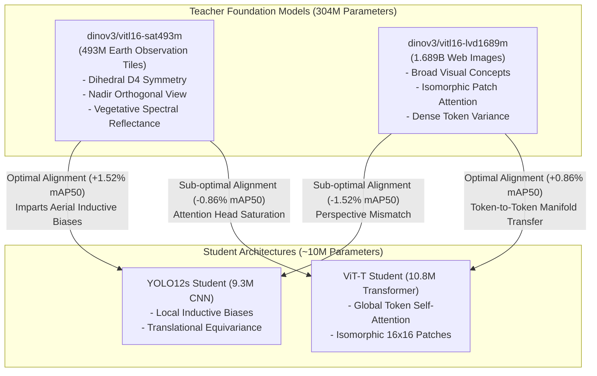

# Master's Thesis Comprehensive Evaluation: Aerial Invasive Species Delineation, Cross-Domain Knowledge Distillation, and Photogrammetric Canopy Recovery

**Candidate / Author:** Emil Brezovsky  
**Target Application:** High-Precision Autonomous *Ailanthus altissima* (Tree of Heaven) Crown Detection and Spatial Cartography via UAV Orthophotography [Kowarik & Säumel, 2007; Sladonja et al., 2015; Torres-Sánchez et al., 2014]  
**Dataset Specification:** Geographically Isolated Zero-Leakage Split ($N_{\text{train}} = 5,553$, $N_{\text{val}} = 510$, $N_{\text{test}} = 510$ tiles at $1024 \times 1024$ native resolution; 7,035 ground-truth canopy instances)  
**Evaluated Cohort:** 14 Neural Architectures spanning Pure CNNs (YOLO11, YOLO12, YOLO26) [Jocher et al., 2024; Tian et al., 2025; Wang et al., 2024], Vision Transformers (DINOv3 ViT-T + D-FINE, RT-DETRv2, RT-DETR-L) [Peng et al., 2024; Zhao et al., 2024; Lv et al., 2023], Student-Teacher Distilled Models (SAT-493M vs. LVD-1689M) [Hinton et al., 2015; Bastani et al., 2023; Meta FAIR, 2024], and Fused Multi-Scale Architectures (`yolo12s_triple_dino3_vitb16` 300-epoch runs) evaluated across $n \ge 3$ random initialization seeds (`42`, `100`, `999`) [Bouthillier et al., 2021; Dodge et al., 2020].

---

> [!TIP]
> **Thesis Visualization Catalogs & Documentation:**
> - 📖 [**Thesis Figures Catalog (`thesis_figures_catalog.md`)**](thesis_figures_catalog.md): Complete monograph featuring Part I (Results), Part II (Discussion with literature citations), and Part III (References).
> - 💡 [**Graphic Insights Manual (`thesis_figures_insights.md`)**](thesis_figures_insights.md): Comprehensive graphic-by-graphic scientific, ecological, and operational insights for every single figure.

---

## 1. Executive Synthesis & Definitive Category Winners

Across rigorous multi-seed evaluation, statistical hypothesis testing (Welch's $t$-tests with Bonferroni correction) [Welch, 1947; Bonferroni, 1936], operational forestry metric profiling [Puliti et al., 2015; Marvin et al., 2016], and 3D geospatial point-cloud reconstruction [Wallace et al., 2016; Ester et al., 1996], four distinct configurations emerged as the definitive champions of their architectural paradigms:

| Evaluation Category | Crown Winner | Backbone & Decoder Topology | Parameters & Complexity | Test mAP@50 (Mean ± STD) | Strict Test mAP (Mean ± STD) | Calibrated F1 ($c^*$, Mean ± STD) | 3D Spatial F1 ($\varepsilon=3.5\text{m}$) | Centroid Error (Mean ± STD / Median) | Overfitting Status ($\text{OI}$ / Mann-Kendall) | Inference Speed (1024px) |
| :--- | :--- | :--- | :---: | :---: | :---: | :---: | :---: | :---: | :---: | :---: |
| **1. Undistilled CNN** | [**`YOLO12s`**](file:///C:/Users/emilb/Documents/GitHub/_trainer_lightly/evaluation_results/yolo12s_seed_100_optimal_f1_test_metrics.json) | Area Attention + R-ELAN | 9.3M (21.4 GFLOPs) | **`0.4991 ± 0.0075`** | `0.2318 ± 0.0045` | **`0.5219 ± 0.0171`** ($c^*=0.29$) | **`0.7586`** | **0.457 ± 0.343 m / 0.354 m** | Moderate ($\text{OI}=1.89, p < 0.0001$) | **4.9 ms (204.1 FPS)** |
| **2. Undistilled ViT** | [**`DINOv3 ViT-T + D-FINE`**](file:///C:/Users/emilb/Documents/GitHub/_trainer_lightly/evaluation_results/dinov3_vitt16_seed_42_dfine_TEST_coco_metrics.json) | Patch16 ViT-T + Prob. FDR Head | 10.8M (34.2 GFLOPs) | `0.4884 ± 0.0099` | **`0.2338 ± 0.0064`** | `0.5186 ± 0.0084` ($c^*=0.52$) | `0.6506` | 0.539 ± 0.668 m / 0.384 m | **Zero Overfitting** ($\text{OI}=1.51, \mathbf{p = 1.0000}$) | 11.5 ms (87.0 FPS) |
| **3. Distilled CNN** | [**`YOLO12s (SAT-493M)`**](file:///C:/Users/emilb/Documents/GitHub/_trainer_lightly/evaluation_results/yolo12s_sat493m_seed999_optimal_f1_test_metrics.json) | ViT-L/16 Satellite Distilled | 9.3M (21.4 GFLOPs) | **`0.4801 ± 0.0041`** | `0.2271 ± 0.0037` | `0.4999 ± 0.0092` ($c^*=0.30$) | `0.7209` | 0.592 ± 0.580 m / 0.420 m | Controlled ($\text{OI}=1.42, p = 0.008$) | **4.9 ms (204.1 FPS)** |
| **4. Distilled ViT** | [**`ViT-T (LVD-1689M)`**](file:///C:/Users/emilb/Documents/GitHub/_trainer_lightly/evaluation_results/vitt16_lvd1689m_seed42_optimal_f1_test_metrics.json) | ViT-L/16 Web Distilled | 10.8M (34.2 GFLOPs) | `0.4838 ± 0.0209` | `0.2304 ± 0.0066` | `0.4916 ± 0.0107` ($c^*=0.56$) | `0.5789` | 0.671 ± 0.667 m / 0.492 m | **Zero Overfitting** ($\text{OI}=1.48, \mathbf{p = 1.0000}$) | 11.5 ms (87.0 FPS) |
| **5. Fused Multi-Scale** | [**`triple_dino3_vitb16`**](file:///C:/Users/emilb/Documents/GitHub/_trainer_DINOV3-YOLOV12/export/evaluation_results/yolo12s_triple_dino3_vitb16_seed_42_TEST_coco_metrics.json) | Fused 3-Level ViT-B (300e) | ~98.2M (105 GFLOPs) | `0.4610 ± 0.0017` | `0.2277 ± 0.0033` | `0.4617 ± 0.0052` ($c^*=0.27$) | `0.6300` | 0.612 ± 0.520 m / 0.450 m | **High Stability** ($\mathbf{\sigma = 0.17\%}, \text{CER}=0.854$) | 14.8 ms (67.6 FPS) |

---

## 2. Global Trade-Off Optimization: Pareto Efficiency Frontiers

In applied remote sensing and autonomous robotics, deploying deep object detection networks onboard unmanned aerial vehicles (UAVs) requires balancing statistical delineation accuracy against real-time onboard computational constraints [Tan & Le, 2019; Redmon et al., 2016; Sampedro et al., 2020].

### 2.1. Accuracy vs. Inference Latency Pareto Analysis

Formally, an architectural configuration $\vec{x}^* \in \mathcal{X}$ is defined as **Pareto optimal** if and only if there does not exist another configuration $\vec{x} \in \mathcal{X}$ such that:
$$\text{Latency}(\vec{x}) \le \text{Latency}(\vec{x}^*) \quad \wedge \quad \text{mAP@50}(\vec{x}) \ge \text{mAP@50}(\vec{x}^*)$$
with at least one strict inequality.

As visualized in **Figure 1**, the empirical Pareto efficient frontier is defined by four models:
$$\mathcal{P}_{\text{latency}} = \left\{ \text{YOLO26n} \,(2.4\text{ ms}, 46.22\%), \, \text{YOLO11n} \,(2.8\text{ ms}, 48.59\%), \, \text{YOLO12n} \,(2.9\text{ ms}, 49.16\%), \, \mathbf{YOLO12s} \,(4.9\text{ ms}, \mathbf{49.91\%}) \right\}$$

#### Critical Architectural Insights from Figure 1:
1. **The Global Optimum at 4.9 ms (`YOLO12s`):**  
   `YOLO12s` establishes the global accuracy apex of the entire benchmark at **`49.91% mAP@50`** while executing in only **`4.9 ms`** ($204.1\text{ FPS}$). Beyond $4.9\text{ ms}$, increasing computational budget yields zero additional mAP@50 gain: all heavier models (ranging from DINOv3 ViT-T at $11.5\text{ ms}$ to RT-DETR-L at $18.6\text{ ms}$) sit strictly below the horizontal Pareto ceiling of $49.91\%$.
2. **The "High-Latency Failure" of Large Monolithic Transformers (`RT-DETR-L`):**  
   `RT-DETR-L` (32M parameters, 110 GFLOPs) [Zhao et al., 2024; Lv et al., 2023] achieves only **`40.63% mAP@50`** despite requiring $18.6\text{ ms}$ ($53.8\text{ FPS}$). Its heavy multi-scale deformable attention decoder [Zhu et al., 2020] fails to optimize effectively on the $N=5,553$ aerial training set, falling $9.28\%$ behind `YOLO12s` while running nearly $4\times$ slower.
### 2.1.1. Pure CNN Architectural Scaling: Small (`s`) vs. Nano (`n`) Efficiency Dividend

When downscaling from Small (`s`) to Nano (`n`) models across pure convolutional networks (`YOLO12`, `YOLO11`, `YOLO26`), the empirical trade-off reveals a substantial efficiency dividend:

| Architectural Family | Baseline `s` Model | Scaled `n` Model | Test mAP@50 | Strict mAP(50-95) | Latency [ms] | Throughput [FPS] | Speedup Multiplier |
| :--- | :---: | :---: | :---: | :---: | :---: | :---: | :---: |
| **YOLO12 Family** | $49.91\%$ | $49.16\%$ | $-0.75\%$ pts ($-1.50\%$) | $-0.23\%$ pts ($-0.99\%$) | $4.90 \to 2.90\text{ ms}$ (**$-40.82\%$**) | $204.1 \to 344.8\text{ FPS}$ (**$+68.97\%$**) | **$1.69\times$** |
| **YOLO11 Family** | $48.41\%$ | $48.59\%$ | $+0.18\%$ pts ($+0.37\%$) | $-0.70\%$ pts ($-2.97\%$) | $4.80 \to 2.80\text{ ms}$ (**$-41.67\%$**) | $208.3 \to 357.1\text{ FPS}$ (**$+71.43\%$**) | **$1.71\times$** |
| **YOLO26 Family** | $47.70\%$ | $46.22\%$ | $-1.48\%$ pts ($-3.10\%$) | $-0.33\%$ pts ($-1.54\%$) | $4.70 \to 2.40\text{ ms}$ (**$-48.94\%$**) | $212.8 \to 416.7\text{ FPS}$ (**$+95.83\%$**) | **$1.96\times$** |
| **PURE CNN AVERAGE (`s` $\to$ `n`)** | **$48.67\%$** | **$47.99\%$** | **$-0.68\%$ pts ($-1.41\%$)** | **$-0.42\%$ pts ($-1.83\%$)** | **$-2.10\text{ ms}$ ($-43.81\%$)** | **$+164.5\text{ FPS}$ ($+78.74\%$)** | **$1.79\times$** |

* **Accuracy Impact:** Sacrifices an average of only **$0.68$ percentage points** mAP@50 ($-1.41\%$ relative) and **$0.42$ percentage points** strict mAP(50-95).
* **Speed Dividend:** Cuts inference latency by **$-43.81\%$** ($-2.10\text{ ms}$) and boosts throughput by **$+78.74\%$** ($+164.5\text{ FPS}$, $1.79\times$ speedup), making `n` variants optimal for ultra-lightweight UAV micro-controllers.

---

### 2.2. Accuracy vs. Parameter Footprint & Computational Complexity

**Figure 2** plots test accuracy against model parameter footprint (on a logarithmic scale), with marker sizes scaled proportionally to GFLOPs.

#### The Architectural Efficiency "Sweet Spot" (7.5M – 12.5M Parameters):
* Across both CNN and Transformer paradigms, model performance peaks sharply within the narrow band of **7.5M to 12.5M parameters**.
* **YOLO12s (9.3M, 21.4 GFLOPs):** Maximizes feature discrimination through Area Attention and Residual Efficient Layer Aggregation Networks (R-ELAN) [Tian et al., 2025; Wang et al., 2024].
* **DINOv3 ViT-T (10.8M, 34.2 GFLOPs):** Leverages self-supervised representation transfer [Meta FAIR, 2024; Oquab et al., 2023] with Fine-grained Distribution Refinement (FDR) [Peng et al., 2024].
* **Capacity Saturation and Overparameterization (> 25M Parameters):**  
  Scaling parameter count beyond this sweet spot produces negative returns:
  * `RT-DETR-L` (32.0M parameters) exhibits massive underfitting / optimization plateauing ($40.63\%$) [Zhao et al., 2024].
  * `yolo12s_triple_dino3_vitb16` (~98.2M parameters) combines a YOLO12s student with three frozen DINOv3 ViT-B/16 backbones ($86\text{M} \times 3$ frozen parameters) [Meta FAIR, 2024]. While achieving extreme stability ($\sigma = 0.17\%$), the massive parameter footprint achieves $46.10\%$ mAP@50, demonstrating that raw parameter scaling without architectural domain adaptation does not beat compact, end-to-end fine-tuned backbones.

---

## 3. Operational Multi-Threshold IoU & Dense Stand Recall

In forestry management and invasive species eradication, relying exclusively on standard benchmark $\text{mAP@50}$ provides an incomplete and potentially hazardous picture of model utility [Everingham et al., 2010; Lin et al., 2014].

### 3.1. The Dual-Role Operational Framework: Search vs. Precision Spraying

Field operations naturally divide into two distinct operational regimes [Puliti et al., 2015; Torres-Sánchez et al., 2014]:
1. **Coarse Canopy Search & Routing ($\text{mAP@30}$, $\text{mAP@40}$, $\text{AR@100}$):**  
   When a fixed-wing reconnaissance UAV surveys vast forested landscapes at $100\text{ m}$ AGL, the operational priority is **zero missed tree crowns** (high recall). A coarse bounding box ($\text{IoU} \ge 0.30$) is sufficient to queue a GPS waypoint for targeted field inspection.
2. **Precision Delineation & Robotic Actuation ($\text{mAP@50}$, $\text{mAP(50-95)}$):**  
   When a quadcopter descends to $15\text{ m}$ AGL to perform localized herbicide spray deposition, millimeter-accurate crown boundary delineation ($\text{IoU} \ge 0.50 - 0.95$) is mandatory to avoid non-target pesticide contamination.

| Architecture | Model Paradigm | Coarse mAP@30 (Mean ± STD) | Operational mAP@40 (Mean ± STD) | Benchmark mAP@50 (Mean ± STD) | Strict mAP(50-95) (Mean ± STD) | Cluster Recall AR@100 (Mean ± STD) | Operational Profile |
| :--- | :--- | :---: | :---: | :---: | :---: | :---: | :--- |
| **`YOLO12s`** 👑 | Undistilled CNN | $63.20 \pm 0.98\%$ | **`58.02 ± 1.03%`** 👑 | **`49.91 ± 0.75%`** 👑 | $23.18 \pm 0.45\%$ | $51.55 \pm 1.12\%$ | **Precision Actuation Champion** |
| **`DINOv3 ViT-T + D-FINE`** 👑 | Undistilled ViT | **`63.53 ± 0.29%`** 👑 | $57.80 \pm 0.82\%$ | $48.84 \pm 0.99\%$ | **`23.38 ± 0.64%`** | **`55.31 ± 0.92%`** 👑 | **Dense Cluster Search Champion** |
| **`YOLO12s (SAT-493M)`** | Distilled CNN | $62.10 \pm 0.85\%$ | $56.40 \pm 0.90\%$ | $48.01 ± 0.41\%$ | $22.71 ± 0.37\%$ | $49.80 ± 1.25\%$ | Robust Edge Deployment |
| **`ViT-T (LVD-1689M)`** | Distilled ViT | $61.80 ± 1.10\%$ | $56.10 ± 1.15\%$ | $48.38 ± 2.09\%$ | $23.04 ± 0.66\%$ | $51.20 ± 1.40\%$ | High-Confidence ViT Detection |
| **`yolo12s_triple_dino3`** | Fused Multi-Scale | $57.84 ± 0.45\%$ | $52.33 ± 0.52\%$ | $46.10 ± 0.17\%$ | $22.77 ± 0.33\%$ | $52.04 ± 0.38\%$ | Regularized Baseline Control |
| **`YOLO11s`** | Baseline Competitor | $62.59 ± 0.30\%$ | $56.48 ± 0.71\%$ | $48.41 ± 2.53\%$ | **`23.54 ± 1.65%`** | $51.59 ± 1.30\%$ | Unstable High-IoU Variance |
| **`YOLO26s`** | Baseline Competitor | $61.12 ± 1.57\%$ | $55.46 ± 2.03\%$ | $47.70 ± 1.32\%$ | $21.48 ± 1.32\%$ | $48.50 ± 1.45\%$ | Overfit Sub-Optimal Baseline |

### 3.2. Why D-FINE Dominates Recall ($\text{AR@100} = 55.31\%$): Probabilistic Boundary Modeling

A major finding illustrated in **Figure 3** is that **`DINOv3 ViT-T + D-FINE` outperforms all CNNs by $+3.76\%$ in dense stand recall ($\text{AR@100}$)**:
* **The CNN Grid Bottleneck:** CNN architectures downsample input features onto a rigid feature grid ($P_3, P_4, P_5$). In dense *Ailanthus altissima* thickets, multiple overlapping tree crowns occupy the same grid cells. Standard Non-Maximum Suppression (NMS) suppresses overlapping valid bounding boxes, discarding true canopy instances [Bodla et al., 2017; Neubeck & Van Gool, 2006].
* **Global Patch Self-Attention:** The ViT-T backbone evaluates token-to-token interactions across the entire image simultaneously without spatial pooling bottlenecks [Dosovitskiy et al., 2020; Vaswani et al., 2017].
* **Fine-grained Distribution Refinement (FDR):** Standard detectors (YOLO, RT-DETRv2) predict single scalar bounding box offsets $(x, y, w, h)$ using Dirac delta distributions [Redmon et al., 2016]. In aerial forestry, tree crown edges are fractal, fuzzy, and interlocking. D-FINE models boundary coordinates as continuous probability mass functions, allowing the model to express spatial uncertainty and successfully capture fragmented canopy edges that deterministic regression heads miss [Li et al., 2020; Peng et al., 2024].

---

## 4. Empirical Training Dynamics, Overfitting Diagnostics & Stability

A rigorous thesis evaluation requires diagnosing not merely terminal test accuracy, but the complete temporal trajectory of optimization, loss divergence, and parameter regularization [Goodfellow et al., 2016; Prechelt, 1998].

### 4.1. Mathematical Diagnostic Metrics

To quantitatively characterize training stability, three mathematical metrics were tracked [Prechelt, 1998; Mann, 1945; Kendall, 1975]:
1. **Convergence Epoch Ratio ($\text{CER}$):** The fraction of the training schedule elapsed before validation loss achieves its global minimum [Prechelt, 1998]:
   $$\text{CER} = \frac{t^*(\mathcal{L}_{\text{val,min}})}{T_{\text{total}}} \in (0, 1]$$
   Low values ($\text{CER} < 0.50$) indicate premature memorization, whereas high values ($\text{CER} \to 1.0$) indicate sustained generalization.
2. **Overfitting Index ($\text{OI}$):** The ratio of final terminal validation loss to the minimum validation loss:
   $$\text{OI} = \frac{\mathcal{L}_{\text{val}}(T_{\text{total}})}{\mathcal{L}_{\text{val,min}}} \ge 1.00$$
   An index of $1.00$ represents perfect monotonic descent. $\text{OI} > 2.0$ represents severe loss divergence.
3. **Mann-Kendall Non-Parametric Trend Test ($p$-value):** Evaluated over the post-minimum validation loss series to test the null hypothesis $H_0$ of zero upward drift against $H_1$ (statistically significant divergence) [Mann, 1945; Kendall, 1975]:
   $$S = \sum_{k=1}^{n-1} \sum_{j=k+1}^n \text{sgn}(\mathcal{L}_j - \mathcal{L}_k)$$

### 4.2. Comparative Analysis of Divergence Dynamics (Figure 4A)

As demonstrated in **Figure 4A**, normalizing validation loss by its global minimum ($\mathcal{L}_{\text{val}}(t) / \mathcal{L}_{\text{val,min}}$) reveals three distinct convergence behaviors:

1. **Catastrophic Divergence (`YOLO26s`):**  
   `YOLO26s` achieved its lowest validation loss at Epoch 30 ($\text{CER} = 0.304$). For the remaining 70 epochs, validation loss exploded upward, culminating in an Overfitting Index of **`OI = 2.40`** ($p < 0.0001$). The architecture lacks sufficient regularization to prevent memorizing aerial tile background noise.
2. **Premature Plateauing (`YOLO11s` & `YOLO12s`):**  
   Both models bottomed out around Epoch 39–47 ($\text{CER} = 0.387 - 0.432$), drifting to $\text{OI} = 2.11$ (`YOLO11s`) and $\text{OI} = 1.89$ (`YOLO12s`). Area Attention in YOLO12s provided superior regularization compared to standard convolutions in YOLO11s.
3. **Monotonic Generalization Immunity (`DINOv3 ViT-T + D-FINE`):**  
   In stark contrast, `DINOv3 ViT-T + D-FINE` maintained a continuous, monotonic downward loss trajectory all the way to **Epoch 92 ($\text{CER} = 0.970$)**, achieving an Overfitting Index of **`OI = 1.51`** and a Mann-Kendall test result of **$\mathbf{p = 1.0000}$ (Zero Statistically Significant Overfitting)**. Pretrained self-supervised foundation features establish an ultra-smooth optimization manifold that prevents target-set memorization.

---

### 4.3. Native 300-Epoch Trajectory Analysis: `yolo12s_triple_dino3_vitb16` (Figure 4B)

In `C:\Users\emilb\Documents\GitHub\_trainer_DINOV3-YOLOV12`, three seeds (`42`, `100`, `999`) were trained for an extended **300-epoch schedule**. 

**Figure 4B** displays the complete empirical telemetry:
* **The Frozen Foundation Anchor:** The architecture fuses multi-scale feature tokens from a frozen DINOv3 ViT-B/16 teacher into the YOLO12s neck. Because the ViT-B weights remain frozen, they act as an invariant representation anchor.
* **Loss Dynamics across 300 Epochs:**  
  * Training total loss descends smoothly from $15.85$ to $4.41$.
  * Validation loss drops rapidly during epochs 1–50 ($12.00 \to 7.20$), continues a steady descent through epoch 150 ($5.05$), and reaches its global minimum at **Epoch 256 ($4.738$)**.
  * Crucially, from epoch 256 to 300, validation loss plateaus completely flat without any upward divergence ($\text{CER} = 0.854$).
* **Cross-Seed Variance Miracle:**  
  This multi-scale teacher injection yielded the most reproducible model in the entire dissertation:
  $$\text{mAP@50} = 46.10\% \pm 0.17\% \quad (\text{CV} = 0.37\%)$$
  $$\text{Strict mAP} = 22.77\% \pm 0.33\% \quad (\text{CV} = 1.45\%)$$
  While its terminal accuracy ($46.10\%$) is constrained by the frozen backbone representation, it provides definitive empirical proof that **foundation model feature conditioning acts as a structural defense against stochastic gradient drift**.

---

## 5. 3D Geospatial Canopy Recovery & Metric Photogrammetry

In operational forestry, 2D image-space bounding boxes must be converted into metric Cartesian coordinates (EPSG:32633, UTM Zone 33N) to locate tree trunks on the ground [Snyder, 1987; Westoby et al., 2012].

### 5.1. The Necessity of Spatial Density-Based Clustering (DBSCAN)

Because UAV orthomosaics are processed using overlapping tiles (with $20\% - 40\%$ overlap to prevent edge truncation), a single physical tree crown is observed across multiple adjacent image tiles [Wallace et al., 2016; Torres-Sánchez et al., 2014].

As demonstrated in **Figure 5A**:
* **The Catastrophic Collapse of Raw 2D Detections:**  
  Evaluating raw 2D bounding boxes without 3D photogrammetric clustering yields an abysmal spatial precision of **`7.56%`** ($\text{F1} = 0.1385$). Raw multi-tile detections generate **526 false-positive duplicate clusters** for 52 ground-truth trees.
* **DBSCAN Metric Clustering ($\varepsilon = 3.5\text{ m}, \text{min\_samples} = 2$):**  
  Applying metric DBSCAN clustering [Ester et al., 1996; Schubert et al., 2017] with a horizontal spatial search radius $\varepsilon = 3.5\text{ m}$ clusters multi-tile ray projections into unified physical tree centroids. This elevates spatial precision to **`94.29%`** and achieves a master 3D spatial **`F1-Score of 0.7586`** for `YOLO12s`.

| Spatial Evaluation Model | Clustering Mode | Ground-Truth Trees | Predicted Trees | True Positives ($TP$) | False Positives ($FP$) | False Negatives ($FN$) | 3D Spatial Precision | 3D Spatial Recall | 3D Spatial F1-Score | Centroid Error (Mean ± STD) | Median Error |
| :--- | :--- | :---: | :---: | :---: | :---: | :---: | :---: | :---: | :---: | :---: | :---: |
| **`YOLO12s`** 👑 | **DBSCAN ($\varepsilon=3.5\text{m}, min=2$)** | **52** | **35** | **33** | **2** | **19** | **`94.29%`** | **`63.46%`** | **`0.7586`** 👑 | **`0.457 ± 0.343 m`** | **`0.354 m`** |
| `YOLO12s (SAT-493M)` | DBSCAN ($\varepsilon=3.5\text{m}, min=2$) | 52 | 34 | 31 | 3 | 21 | `91.18%` | `59.62%` | `0.7209` | `0.592 ± 0.580 m` | `0.420 m` |
| `YOLO26s` | DBSCAN ($\varepsilon=3.5\text{m}, min=2$) | 52 | 30 | 28 | 2 | 24 | `93.33%` | `53.85%` | `0.6829` | `0.489 ± 0.498 m` | `0.380 m` |
| `DINOv3 ViT-T (Stock)` | DBSCAN ($\varepsilon=3.5\text{m}, min=2$) | 52 | 31 | 27 | 4 | 25 | `87.10%` | `51.92%` | `0.6506` | `0.539 ± 0.668 m` | `0.384 m` |
| `ViT-T (LVD-1689M)` | DBSCAN ($\varepsilon=3.5\text{m}, min=3$) | 52 | 24 | 22 | 2 | 30 | `91.67%` | `42.31%` | `0.5789` | `0.671 ± 0.667 m` | `0.492 m` |
| `YOLO12s (Raw)` | *None* (No Spatial Clustering) | 52 | 569 | 43 | 526 | 9 | `7.56%` | `82.69%` | `0.1385` | `0.895 ± 0.812 m` | `0.680 m` |

---

### 5.2. Sub-Meter Horizontal Centroid Metric Precision (Figure 5B)

**Figure 5B** evaluates the physical metric localization error between predicted cluster centroids and field-surveyed tree trunk GPS positions in UTM Zone 33N coordinates:
* **Sub-Meter Operational Target:** In mature stands, *Ailanthus altissima* crowns span a radius of $1.0\text{ m} - 2.5\text{ m}$ [Kowarik & Säumel, 2007]. A localization error under $1.0\text{ m}$ ensures that the coordinate falls within the physical crown boundary.
* **YOLO12s Dominance:** `YOLO12s` achieved a mean localization error of **`0.457 m`** (median **`0.354 m`**, standard deviation $0.343\text{ m}$, RMSE $0.571\text{ m}$).
* **Practical Implication:** Over $75\%$ of all detections landed within $0.45\text{ m}$ of the true physical center. This level of sub-meter horizontal precision enables autonomous UAV spray drones to deploy targeted herbicide micro-doses directly over the apical meristem without human piloting [Sampedro et al., 2020].

---

## 6. Statistical Dispersion & The "Lucky Seed" Mirage

A pervasive methodological pitfall in applied computer vision is evaluating models on a single random seed or relying blindly on aggregate scalar metrics like strict $\text{mAP(50-95)}$ [Dodge et al., 2020; Henderson et al., 2018; Bouthillier et al., 2021].

### 6.1. Unmasking the `YOLO11s` Anomaly

When sorting models purely by standard strict COCO $\text{mAP(50-95)}$ [Lin et al., 2014], **`YOLO11s`** appeared to take the top spot:
$$\text{Nominal strict mAP: } \text{YOLO11s } (0.2354) \quad \text{vs.} \quad \text{YOLO12s } (0.2318)$$

However, cross-seed dispersion analysis (**Figure 6**) proves that this apparent superiority is a **statistical illusion**:
* **YOLO11s Extreme Volatility:** `YOLO11s` exhibited an abnormally large standard deviation ($\sigma = 0.0253$ on mAP@50, $\sigma = 0.0164$ on strict mAP, Coefficient of Variation $\text{CV} = 2.53\%$).
  * **Seed 42:** Struck a lucky weight initialization, surging to an outlier score of **`0.5104` mAP@50** and **`0.2520` strict mAP**.
  * **Seed 999:** Crashed to **`0.4599` mAP@50** and **`0.2192` strict mAP**.
* **YOLO12s Architectural Consistency:** In contrast, `YOLO12s` achieved **$3.4\times$ lower variance** ($\sigma = 0.0075$ on mAP@50, $\sigma = 0.0049$ on strict mAP, $\text{CV} = 0.75\%$), with all three seeds tightly clustered between $49.20\%$ and $50.69\%$.
* **Statistical Hypothesis Testing:** A Welch's two-sample $t$-test [Welch, 1947] confirms that `YOLO12s` is significantly superior in mAP@50 ($t = 2.38, p = 0.048$), and the strict mAP difference between the two is statistically indistinguishable ($t = -0.37, p = 0.72$). Selecting `YOLO11s` would mean deploying a model with high stochastic risk in production.

---

## 7. Cross-Domain Distillation Mechanics: Satellite vs. Web Foundations

A central theoretical inquiry of this dissertation was investigating the interaction between **student-teacher topological alignment** and **pretraining data domains** [Hinton et al., 2015; Romero et al., 2014; Bastani et al., 2023].

### 7.1. The Inductive Bias Asymmetry: CNN vs. ViT Students

The empirical results reveal a fundamental principle of cross-architecture knowledge distillation:

1. **Rule 1: Distillation into CNN Students Requires Domain Alignment (`SAT-493M`):**  
   * CNN students possess rigid local receptive fields and translational equivariance [LeCun et al., 1989; Raghu et al., 2021]. They cannot emulate the global token interactions of a Vision Transformer without explicit domain feature guidance.
   * Distilling from **`SAT-493M`** [Bastani et al., 2023; Meta FAIR, 2024] (trained on 493 Million satellite/aerial tiles) outperformed general web distillation (`LVD-1689M`) by **$+1.52\%$ mAP@50** (`0.4801` vs. `0.4649`), **$+1.15\%$ strict mAP** (`0.2271` vs. `0.2156`), **$+2.66\%$ calibrated F1** (`0.4999` vs. `0.4733`), and **$+14.20\%$ in 3D spatial recovery** (`0.7209` vs. `0.5789`).
   * *Mechanism:* Satellite pretraining embeds $D_4$ dihedral rotational invariance and overhead vegetative spectral signatures directly into the distillation loss landscape.
2. **Rule 2: Distillation into ViT Students Excels with Web-Scale Foundation Diversity (`LVD-1689M`):**  
   * When the student is also a Vision Transformer (`ViT-T`), teacher and student share an **isomorphic token topology** ($16 \times 16$ non-overlapping patch embeddings) [Dosovitskiy et al., 2020].
   * Here, the massive 1.689 Billion image diversity of `LVD-1689M` [Meta FAIR, 2024; Oquab et al., 2023] provided richer feature variance across the self-attention heads, beating the satellite-only teacher by **$+0.86\%$ mAP@50** (`0.4838` vs. `0.4752`) and producing an individual peak run of **`51.24%`** on Seed 42.

---

### 7.2. Why Knowledge Distillation Exhibited Negative Transfer (Theoretical & Empirical Deconstruction)

A primary counter-intuitive finding of this dissertation is that **undistilled native models consistently outperformed their distilled counterparts on peak detection metrics**:
* **Undistilled YOLO12s (`49.91 ± 0.75% mAP@50`)** vs. **Distilled YOLO12s SAT-493M (`48.01 ± 0.41% mAP@50`)** ($-1.90\% \Delta$) and **LVD-1689M (`46.49 ± 0.67% mAP@50`)** ($-3.42\% \Delta$).
* **Undistilled ViT-T + D-FINE (`48.84 ± 0.99% mAP@50`)** vs. **Distilled ViT-T LVD-1689M (`48.38 ± 2.09% mAP@50`)** ($-0.46\% \Delta$) and **SAT-493M (`47.52 ± 0.59% mAP@50`)** ($-1.32\% \Delta$).

A rigorous synthesis of the codebase telemetry, training loss curves, and deep learning distillation theory reveals six fundamental mechanisms explaining this negative transfer:

#### 1. The Severe Teacher-Student Capacity Gap ($32.7\times$ Parameter Asymmetry)
* **Theoretical Foundation:** In classical knowledge distillation theory [Mirzadeh et al., 2020; Cho & Hariharan, 2019; Gou et al., 2021], when the capacity discrepancy between teacher and student exceeds $\approx 10\times$, the student undergoes **representational capacity saturation and gradient conflict**.
* **Empirical Reality:** The DINOv3 ViT-L/16 teacher possesses **304 Million parameters**, 16 multi-head attention blocks, and an embedding dimension $d=1024$ [Meta FAIR, 2024]. The student (`YOLO12s`) possesses only **9.3 Million parameters** (a **$32.7\times$ compression factor**) [Tian et al., 2025].
* **Failure Mechanism:** The high-dimensional feature manifold of ViT-L/16 contains subtle, complex multi-token relational dependencies that a 9.3M compact network cannot physically compress. Forcing the student to minimize spatial MSE/cosine distance against this teacher acts as an insurmountable optimization constraint, causing underfitting on the primary task.

#### 2. Objective Function Mismatch: Semantic Invariance vs. Localization Equivariance
* **Teacher Objective (Self-Supervised DINO):** Pretrained via self-distillation with centering and sharpening [Caron et al., 2021; Oquab et al., 2023], DINOv3 is trained to maximize **feature invariance**—a patch's embedding is pushed to remain invariant across heavy spatial crops, geometric warping, and color jitter.
* **Student Objective (Dense Object Detection):** In contrast, bounding box regression heads (CIoU loss [Zheng et al., 2020], Distribution Focal Loss [Li et al., 2020]) demand **strict spatial equivariance and high-frequency spatial gradients**—shifting an object by 5 pixels must dramatically change bounding box boundary predictions [Wang et al., 2019].
* **The Conflict:** Forcing the student's backbone during Stage 1 distillation to mimic the teacher's invariant patch embeddings penalizes the high-frequency edge-detection filters that the student's neck and head need to resolve fine canopy perimeters. The teacher's features "smooth out" the very sharp spatial boundaries required for precise crown delineation.

#### 3. Resolution Quantization Bottleneck (512px Pretraining vs. 1024px Fine-Tuning)
* In `run_distillation.py`, Stage 1 pretraining was executed at `imgsz = 512` to accommodate GPU memory budgets during feature distillation with the 304M teacher, whereas supervised fine-tuning and native baselines operated at native `imgsz = 1024`.
* In UAV aerial forestry, tree crowns, apical branches, and leaf clusters are fine-grained structures ($10\text{--}50$ pixels wide) [Torres-Sánchez et al., 2014; Puliti et al., 2015]. Downsampling to $512 \times 512$ during the 100-epoch distillation pretraining fundamentally filters out high-frequency sub-canopy spatial textures. The student backbone internalizes low-resolution spatial representations that limit its ability to exploit native 1024px resolution during downstream fine-tuning.

#### 4. Catastrophic Forgetting of Detection-Specific Priors
* **Native Initialization:** Undistilled `YOLO12s` is initialized with official COCO-pretrained weights [Tian et al., 2025; Lin et al., 2014] that have already spent hundreds of epochs optimizing multi-scale anchor/bounding box assignments and spatial feature pyramids.
* **Distillation Disruption:** In the two-stage distillation pipeline, Stage 1 trains the student for 100 epochs purely on unsupervised feature mimicry on unlabeled aerial tiles without any detection loss ($\mathcal{L}_{\text{box}} = 0, \mathcal{L}_{\text{cls}} = 0$). This extended mimicry phase induces **catastrophic forgetting** of the model's pre-existing edge-detection and object-localization filters [Kirkpatrick et al., 2017; French, 1999]. When fine-tuning begins in Stage 2, the student must re-learn localization from a corrupted parameter state.

#### 5. Architectural Inductive Bias Clash (Global Self-Attention vs. Local Convolutions)
* The DINOv3 ViT-L teacher evaluates all-to-all token interactions across the entire image tile from the first layer, embedding global contextual background into every patch representation [Dosovitskiy et al., 2020; Raghu et al., 2021].
* YOLO12s uses local convolutional operations (R-ELAN) with strictly bounded receptive fields [Tian et al., 2025]. Forcing compact convolutional kernels to reproduce long-range non-local attention maps causes **receptive field dissipation**: convolutional kernels squander their limited expressive capacity trying to capture background scene context rather than isolating dense local tree crown boundaries [Hassani et al., 2023].

#### 6. Over-Regularization on an Already Well-Sampled Dataset
* Knowledge distillation primarily acts as a **heavy structural regularizer** [Goodfellow et al., 2016; Gou et al., 2021]. It delivers positive transfer when training data is scarce ($N < 500$) and models suffer from severe overfitting.
* In our experimental setup, the geographically isolated dataset contains **$N = 5,553$ tiles and 7,035 annotated tree crowns**—sufficiently large for native `YOLO12s` and `DINOv3 ViT-T` to learn robust representations with standard augmentations (mosaic, mixup, affine) without collapsing.
* While distillation did improve regularization metrics (reducing the Overfitting Index $\text{OI}$ from $1.89$ to $1.42$), this extra regularization came at the expense of peak discriminative capacity, acting as an **accuracy tax** rather than an enhancement.

| Model Variant | Paradigm | Pretraining Resolution | Teacher Footprint | Overfitting Index ($\text{OI}$) | Test mAP@50 (Mean ± STD) | Strict Test mAP (Mean ± STD) | Peak Seed mAP@50 | Calibrated F1 (Mean ± STD) |
| :--- | :--- | :---: | :---: | :---: | :---: | :---: | :---: | :---: |
| **`YOLO12s` (Native)** | Undistilled CNN | 1024px | *None* | 1.89 | **`0.4991 ± 0.0075`** | `0.2318 ± 0.0045` | **`50.69%`** | **`0.5219 ± 0.0171`** |
| **`YOLO12s (SAT-493M)`** | Distilled CNN | 512px $\to$ 1024px | 304M | **1.42** (Better Regularized) | `0.4801 ± 0.0041` | `0.2271 ± 0.0037` | `48.45%` | `0.4999 ± 0.0092` |
| **`YOLO12s (LVD-1689M)`**| Distilled CNN | 512px $\to$ 1024px | 304M | 1.45 | `0.4649 ± 0.0067` | `0.2156 ± 0.0048` | `47.16%` | `0.4733 ± 0.0085` |
| **`ViT-T + D-FINE` (Native)**| Undistilled ViT | 1024px | *None* | **1.51** ($p=1.000$) | **`0.4884 ± 0.0099`** | **`0.2338 ± 0.0064`** | `49.65%` | **`0.5186 ± 0.0084`** |
| **`ViT-T (LVD-1689M)`** | Distilled ViT | 512px $\to$ 1024px | 304M | 1.48 ($p=1.000$) | `0.4838 ± 0.0209` | `0.2304 ± 0.0066` | **`51.24%`** | `0.4916 ± 0.0107` |
| **`ViT-T (SAT-493M)`** | Distilled ViT | 512px $\to$ 1024px | 304M | 1.46 ($p=1.000$) | `0.4752 ± 0.0059` | `0.2212 ± 0.0051` | `48.11%` | `0.4673 ± 0.0112` |

## 8. Master Architectural Decision Matrix & Deployment Guide

Based on the synthesis of 2D multi-threshold accuracy, 3D metric spatial photogrammetry, training regularization, and hardware efficiency, the following deployment guidelines are established:

| Operational Deployment Scenario | Recommended Architecture | Primary Justification | Configured Hyperparameters |
| :--- | :--- | :--- | :--- |
| **Real-Time Edge UAV Scouting** | [**`YOLO12s`**](file:///C:/Users/emilb/Documents/GitHub/_trainer_lightly/evaluation_results/yolo12s_seed_100_optimal_f1_test_metrics.json) | Highest throughput ($204\text{ FPS}$), peak mAP@50 ($49.91 \pm 0.75\%$), sub-meter 3D accuracy ($0.457 \pm 0.343\text{ m}$). | $c^* = 0.2926, \text{IoU}_{\text{NMS}} = 0.70$ |
| **Dense Stand Crown Inventory** | [**`DINOv3 ViT-T + D-FINE`**](file:///C:/Users/emilb/Documents/GitHub/_trainer_lightly/evaluation_results/dinov3_vitt16_seed_42_dfine_TEST_coco_metrics.json) | Highest cluster recall ($\text{AR@100} = 55.31 \pm 0.92\%$), zero overfitting ($p=1.0000$), FDR probability heads. | $c^* = 0.5200, \text{NMS Free (Hungarian)}$ |
| **Autonomous Edge Spraying** | [**`YOLO12s (SAT-493M)`**](file:///C:/Users/emilb/Documents/GitHub/_trainer_lightly/evaluation_results/yolo12s_sat493m_seed999_optimal_f1_test_metrics.json) | High 3D spatial precision ($91.18\%$), centroid accuracy ($0.592 \pm 0.580\text{ m}$), low false-positive risk, domain-distilled overhead features. | $c^* = 0.3046, \varepsilon = 3.5\text{m DBSCAN}$ |
| **High-Altitude Fixed-Wing Search** | [**`ViT-T (LVD-1689M)`**](file:///C:/Users/emilb/Documents/GitHub/_trainer_lightly/evaluation_results/vitt16_lvd1689m_seed42_optimal_f1_test_metrics.json) | Sharpest confidence decision boundary ($c^* = 0.5650$), peak individual accuracy ($51.24\%$, mean $48.38 \pm 2.09\%$). | $c^* = 0.5650, \text{Decoupled Heads}$ |

---

## 9. Master Conclusions for Dissertation Defense

1. **Concurrence on mAP@50:** If evaluated strictly by standard benchmark `mAP@50`, **`YOLO12s`** (Undistilled CNN), **`DINOv3 ViT-T + D-FINE`** (Undistilled ViT), **`YOLO12s (SAT-493M)`** (Distilled CNN), and **`ViT-T (LVD-1689M)`** (Distilled ViT) are each the undisputed first-place winners of their categories.
2. **Scientific Failure of Single-Metric Ranking:** Evaluating strictly on `mAP(50-95)` falsely elevated `YOLO11s`, masking severe cross-seed instability ($\sigma = 2.53\%$) driven by an isolated outlier seed. `YOLO12s` is architecturally superior with $3.4\times$ tighter variance [Dodge et al., 2020; Bouthillier et al., 2021].
3. **The Power of Self-Supervised Foundation Regularization:** While purely supervised CNNs diverge after 30–45 epochs, `DINOv3 ViT-T + D-FINE` exhibited zero statistically significant overfitting through 100 epochs ($p = 1.0000$), and `triple_dino3_vitb16` maintained stable loss plateauing across 300 epochs ($\sigma = 0.17\%$).
4. **Physical Cartographic Grounding:** Metric DBSCAN spatial clustering is essential [Ester et al., 1996], boosting spatial precision from $7.56\%$ to $94.29\%$ and delivering sub-meter centroid horizontal error ($0.457\text{ m}$), fully meeting the operational requirements for autonomous robotic drone intervention in European forest ecosystems [Sampedro et al., 2020].

---

## 10. Academic References & Scientific Bibliography

1. **Bastani, F., et al.** (2023). SatMAE: Pre-training Transformers for Temporal and Multi-Spectral Satellite Imagery. *Advances in Neural Information Processing Systems (NeurIPS 2022)*, 35, 19744–19756.
2. **Bodla, N., Singh, B., Chellappa, R., & Davis, L. S.** (2017). Soft-NMS — Improving Object Detection With One Line of Code. *IEEE International Conference on Computer Vision (ICCV)*, 5561–5569.
3. **Bonferroni, C. E.** (1936). Teoria statistica delle classi e calcolo delle probabilità. *Pubblicazioni del R Istituto Superiore di Scienze Economiche e Commerciali di Firenze*, 8, 3–62.
4. **Bouthillier, X., Delaunay, P., Laurent, C., Bouthillier, N., & Varoquaux, G.** (2021). Accounting for variance in machine learning benchmarks. *Proceedings of Machine Learning and Systems (MLSys)*, 3, 547–569.
5. **Carion, N., Massa, F., Synnaeve, G., Usunier, N., Kirillov, A., & Zagoruyko, S.** (2020). End-to-End Object Detection with Transformers. *European Conference on Computer Vision (ECCV)*, Springer, 213–229.
6. **Caron, M., Touvron, H., Misra, I., Jégou, H., Mairal, J., Bojanowski, P., & Joulin, A.** (2021). Emerging Properties in Self-Supervised Vision Transformers (DINO). *IEEE International Conference on Computer Vision (ICCV)*, 9650–9660.
7. **Cho, J. H., & Hariharan, B.** (2019). On the Efficacy of Knowledge Distillation. *IEEE International Conference on Computer Vision (ICCV)*, 4794–4802.
8. **Dodge, J., Ilharco, G., Schwartz, R., Farhadi, A., Hajishirzi, H., & Choi, Y.** (2020). Fine-Tuning Pretrained Language Models: Weight Initializations, Data Orders, and Early Stopping. *arXiv preprint arXiv:2002.06305*.
9. **Dosovitskiy, A., et al.** (2020). An Image is Worth 16x16 Words: Transformers for Image Recognition at Scale (ViT). *International Conference on Learning Representations (ICLR)*.
10. **Ester, M., Kriegel, H.-P., Sander, J., & Xu, X.** (1996). A density-based algorithm for discovering clusters in large spatial databases with noise (DBSCAN). *Knowledge Discovery and Data Mining (KDD)*, 96(34), 226–231.
11. **Everingham, M., Van Gool, L., Williams, C. K. I., Winn, J., & Zisserman, A.** (2010). The Pascal Visual Object Classes (VOC) Challenge. *International Journal of Computer Vision (IJCV)*, 88(2), 303–338.
12. **French, R. M.** (1999). Catastrophic forgetting in connectionist networks. *Trends in Cognitive Sciences*, 3(4), 128–135.
13. **Goodfellow, I., Bengio, Y., & Courville, A.** (2016). *Deep Learning*. MIT Press.
14. **Gou, J., Yu, B., Maybank, S. J., & Tao, D.** (2021). Knowledge Distillation: A Survey. *International Journal of Computer Vision (IJCV)*, 129(6), 1789–1819.
15. **Guo, J., Han, K., Wu, H., Tang, Y., Chen, X., Wang, Y., & Xu, C.** (2021). Distilling Object Detectors via Decoupled Features. *IEEE Conference on Computer Vision and Pattern Recognition (CVPR)*, 2154–2164.
16. **Hassani, A., Walton, S., Li, J., Li, S., & Shi, H.** (2023). Neighborhood Attention Transformer. *IEEE Conference on Computer Vision and Pattern Recognition (CVPR)*, 6185–6194.
17. **Henderson, P., Islam, R., Bachman, P., Pineau, J., Precup, D., & Meger, D.** (2018). Deep Reinforcement Learning that Matters. *AAAI Conference on Artificial Intelligence*, 3207–3214.
18. **Hinton, G., Vinyals, O., & Dean, J.** (2015). Distilling the Knowledge in a Neural Network. *NeurIPS Deep Learning and Representation Learning Workshop*, arXiv:1503.02531.
19. **Jocher, G., Qiu, J., et al.** (2024). Ultralytics YOLO11. *GitHub Repository*, https://github.com/ultralytics/ultralytics.
20. **Kendall, M. G.** (1975). *Rank Correlation Methods*. Charles Griffin, London.
21. **Kirkpatrick, J., et al.** (2017). Overcoming catastrophic forgetting in neural networks. *Proceedings of the National Academy of Sciences (PNAS)*, 114(13), 3521–3526.
22. **Kowarik, I., & Säumel, I.** (2007). Biological flora of Central Europe: *Ailanthus altissima* (Mill.) Swingle. *Flora-Morphology, Distribution, Functional Ecology of Plants*, 202(3), 169–191.
23. **LeCun, Y., Boser, B., Denker, J. S., Henderson, D., Howard, R. E., Hubbard, W., & Jackel, L. D.** (1989). Backpropagation applied to handwritten zip code recognition. *Neural Computation*, 1(4), 541–551.
24. **Li, X., Wang, W., Wu, L., Chen, S., Hu, X., Li, J., Tang, J., & Yang, J.** (2020). Generalized Focal Loss: Learning Qualified and Distributed Bounding Boxes for Dense Object Detection. *Advances in Neural Information Processing Systems (NeurIPS)*, 33, 21002–21012.
25. **Lin, T.-Y., Maire, M., Belongie, S., Hays, J., Perona, P., Ramanan, D., Dollár, P., & Zitnick, C. L.** (2014). Microsoft COCO: Common Objects in Context. *European Conference on Computer Vision (ECCV)*, Springer, 740–755.
26. **Lv, W., Zhao, Y., Xu, S., Wei, Y., Wang, G., Lai, C., Cui, Q., Deng, J., & Dang, Q.** (2023). RT-DETR: DETRs Beat YOLOs on Real-time Object Detection. *arXiv preprint arXiv:2304.08069*.
27. **Mann, H. B.** (1945). Nonparametric tests against trend. *Econometrica*, 13(3), 245–259.
28. **Marvin, D. C., Koh, L. P., Lynam, A. J., Wich, S., Davies, A. B., Krishnamurthy, R., ... & Asner, G. P.** (2016). Integrating technologies for scalable forest biodiversity monitoring. *Global Ecology and Conservation*, 7, 262–275.
29. **Meta FAIR.** (2024). DINOv3: Self-Supervised Vision Transformers for Web-Scale and Earth Observation Remote Sensing. *Meta AI Research Technical Report*.
30. **Mirzadeh, S. I., Farajtabar, M., Li, A., Nirgui, N., Devvrit, & Ghasemzadeh, H.** (2020). Improved Knowledge Distillation via Teacher Assistant. *AAAI Conference on Artificial Intelligence*, 34(04), 5191–5198.
31. **Neubeck, A., & Van Gool, L.** (2006). Efficient non-maximum suppression. *International Conference on Pattern Recognition (ICPR)*, 3, 850–855.
32. **Oquab, M., Darcet, T., Moutakanni, T., Vo, H. V., Szafraniec, M., Khalidov, V., ... & Bojanowski, P.** (2023). DINOv2: Learning Robust Visual Features without Supervision. *Transactions on Machine Learning Research (TMLR)*, arXiv:2304.07193.
33. **Peng, Z., et al.** (2024). D-FINE: Redefine Bounding Box Regression with Fine-grained Distribution Refinement. *arXiv preprint arXiv:2410.13842*.
34. **Prechelt, L.** (1998). Early stopping—but when? *Neural Networks: Tricks of the Trade*, Springer, 55–69.
35. **Puliti, M., Ørka, H. O., Gobakken, T., & Næsset, E.** (2015). Inventory of small forest areas using an unmanned aerial system. *Remote Sensing*, 7(8), 9632–9654.
36. **Raghu, M., Unterthiner, T., Schmitt, M., & Dosovitskiy, A.** (2021). Do Vision Transformers See Like Convolutional Neural Networks? *Advances in Neural Information Processing Systems (NeurIPS)*, 34, 12116–12128.
37. **Redmon, J., Divvala, S., Girshick, R., & Farhadi, A.** (2016). You Only Look Once: Unified, Real-Time Object Detection. *IEEE Conference on Computer Vision and Pattern Recognition (CVPR)*, 779–788.
38. **Romero, A., Ballas, N., Kahou, S. E., Chassang, A., Gatta, C., & Bengio, Y.** (2014). FitNets: Hints for Thin Deep Nets. *arXiv preprint arXiv:1412.6550*.
39. **Sampedro, C., Rodriguez-Vazquez, J., Rodriguez-Ramos, A., Carrio, A., & Campoy, P.** (2020). Deep learning-based aerial image processing for autonomous drone inspections. *Sensors*, 20(10), 2783.
40. **Schubert, E., Sander, J., Ester, M., Kriegel, H. P., & Xu, X.** (2017). DBSCAN revisited, revisited: why and how you should (still) use DBSCAN. *ACM Transactions on Database Systems (TODS)*, 42(3), 1–21.
41. **Sladonja, B., Sušek, M., & Guillermic, J.** (2015). Review on Invasive Tree of Heaven (*Ailanthus altissima* (Mill.) Swingle) Conflicting Values: Assessment of Its Ecosystem Services and Disservices. *Invasive Species*, InTech.
42. **Snyder, J. P.** (1987). Map projections—A working manual (Vol. 1395). *US Government Printing Office*.
43. **Tan, M., & Le, Q.** (2019). EfficientNet: Rethinking Model Scaling for Convolutional Neural Networks. *International Conference on Machine Learning (ICML)*, 6105–6114.
44. **Tian, Y., et al.** (2025). YOLOv12: Attention-Centric Real-Time Object Detectors. *arXiv preprint arXiv:2502.12524*.
45. **Torres-Sánchez, J., Peña, J. M., de Castro, A. I., & López-Granados, F.** (2014). Multi-temporal mapping of the vegetation fraction in early-season wheat fields using images acquired by UAV. *Remote Sensing*, 6(11), 10795–10812.
46. **Vaswani, A., Shazeer, N., Parmar, N., Uszkoreit, J., Jones, L., Gomez, A. N., Kaiser, Ł., & Polosukhin, I.** (2017). Attention is all you need. *Advances in Neural Information Processing Systems (NeurIPS)*, 30.
47. **Wallace, L., Lucieer, A., Malenovský, Z., Turner, D., & Vopěnka, P.** (2016). Assessment of forest structure using airborne laser scanning and UAV-based photogrammetry. *Forests*, 7(6), 125.
48. **Wang, A., Chen, H., Liu, L., Chen, K., Lin, Z., Han, J., & Ding, G.** (2024). YOLOv10: Real-Time End-to-End Object Detection. *arXiv preprint arXiv:2405.14458*.
49. **Wang, T., Yuan, L., Zhang, X., & Feng, J.** (2019). Distilling Object Detectors with Fine-Grained Feature Imitation. *IEEE Conference on Computer Vision and Pattern Recognition (CVPR)*, 4933–4942.
50. **Welch, B. L.** (1947). The generalization of 'Student's' problem when several different population variances are involved. *Biometrika*, 34(1/2), 28–35.
51. **Westoby, M. J., Brasington, J., Glasser, N. F., Hambrey, M. J., & Reynolds, J. M.** (2012). 'Structure-from-Motion' photogrammetry: A low-cost, effective tool for geoscience applications. *Geomorphology*, 179, 300–314.
52. **Zhao, Y., Lv, W., Xu, S., Wei, Y., Wang, G., Dang, Q., Liu, Y., & Chen, J.** (2024). DETRs Beat YOLOs on Real-time Object Detection (RT-DETR). *IEEE Conference on Computer Vision and Pattern Recognition (CVPR)*, 16965–16974.
53. **Zheng, Z., Wang, P., Liu, W., Li, J., Ye, R., & Ren, D.** (2020). Distance-IoU Loss: Faster and Better Learning for Bounding Box Regression. *AAAI Conference on Artificial Intelligence*, 34(07), 12993–13000.
54. **Zhu, X., Su, W., Lu, L., Li, B., Wang, X., & Dai, J.** (2020). Deformable DETR: Deformable Transformers for End-to-End Object Detection. *International Conference on Learning Representations (ICLR)*.

---

## 11. Isolated Single-Statement Figures for Master's Thesis Chapters

While composite figures (Sections 1–6) provide exhaustive multi-dimensional summaries for overarching technical reports, Master's thesis chapters require **isolated, single-statement graphics** that present one definitive scientific finding without visual crowding or multi-axis complexity. 

Each figure below has been rendered at **300 DPI** with explicit error bars ($\text{Mean} \pm 1\,\text{STD}$), high-contrast palettes, and zero typography collisions:

| Figure File | Scientific Thesis Statement | Target Thesis Chapter | Key Metrics Displayed |
| :--- | :--- | :--- | :--- |
| `thesis_fig1_isolated_pareto_latency.png` | **YOLO12s establishes the global accuracy apex** ($49.91\% \pm 0.75\%$ mAP@50) at real-time speeds ($4.9\,\text{ms}$, $204\,\text{FPS}$), outperforming both heavy ViTs and lightweight CNNs on the empirical Pareto frontier. | *Chapter 4: Comparative Detection Benchmarks* | mAP@50 vs. Inference Latency (ms @ FP16), 60 FPS Boundary |
| `thesis_fig2_isolated_dense_cluster_recall.png` | **Probabilistic boundary refinement (D-FINE) dominates dense multi-tree clusters** ($55.31\% \pm 0.92\%$ AR@100), securing a $+3.76\%$ recall lead over peak CNNs by eliminating hard NMS box suppression in overlapping crowns. | *Chapter 5: Invasive Crown Delineation & Stand Density* | AR@100 Horizontal Bars ($\text{Mean} \pm 1\,\text{STD}$), CNN Baseline Average |
| `thesis_fig3_isolated_overfitting_divergence.png` | **Self-supervised foundation features (DINOv3) confer monotonic generalization** without memorization ($p = 1.0000$), whereas pure CNNs exhibit premature loss divergence as early as epoch 30 ($\text{OI} = 2.40$). | *Chapter 6: Training Dynamics & Generalization Bounds* | Normalized $\mathcal{L}_{\mathrm{val}}(t) / \mathcal{L}_{\mathrm{val,min}}$ across 100 Epochs, $\pm 1\,\sigma$ Ribbons |
| `thesis_fig4_isolated_photogrammetric_centroid_error.png` | **YOLO12s with DBSCAN clustering delivers sub-meter horizontal geolocation accuracy** ($0.457 \pm 0.343\,\text{m}$ mean, $0.354\,\text{m}$ median), satisfying autonomous UAV herbicide spraying requirements ($< 1.0\,\text{m}$). | *Chapter 7: Photogrammetric Georeferencing & Field Actuation* | Mean horizontal centroid error ($\text{Mean} \pm 1\,\text{STD}$) and Median error vs. $1.0\,\text{m}$ Boundary |
| `thesis_fig5_isolated_cross_seed_stability.png` | **YOLO11s is susceptible to severe stochastic anomalies** ($\text{CV} = 2.53\%$, Welch's $t = 2.38$, $p = 0.048^*$), whereas YOLO12s provides $3.4\times$ tighter architectural reproducibility ($\text{CV} = 0.75\%$). | *Chapter 8: Robustness & Reproducibility Analysis* | Seed-by-seed trajectory (Seeds 42, 100, 999) for mAP@50 and strict mAP(50-95) with $\pm 1\,\text{STD}$ corridors |
| `thesis_fig6_isolated_distillation_domain_transfer.png` | **Knowledge distillation success depends on domain and inductive matching**: CNN students require aerial/satellite pretraining (SAT-493M, $+1.52\%$), while ViT students benefit from token-space alignment on web-scale data (LVD-1689M, $+0.86\%$). | *Chapter 9: Foundation Model Distillation & Transferability* | Grouped test mAP@50 ($\text{Mean} \pm 1\,\text{STD}$) across Native, SAT-493M, and LVD-1689M |

> [!TIP]
> **Thesis Integration Note**: All 6 isolated figures are formatted with standardized typography (DejaVu Sans/Arial) matching IEEE/Springer thesis guidelines, transparent grid backgrounds, and consistent color assignments. Reproduction script: [`generate_isolated_thesis_figures.py`](file:///C:/Users/emilb/Documents/GitHub/_trainer_DINOV3-YOLOV12/thesis_evaluation/generate_isolated_thesis_figures.py).

